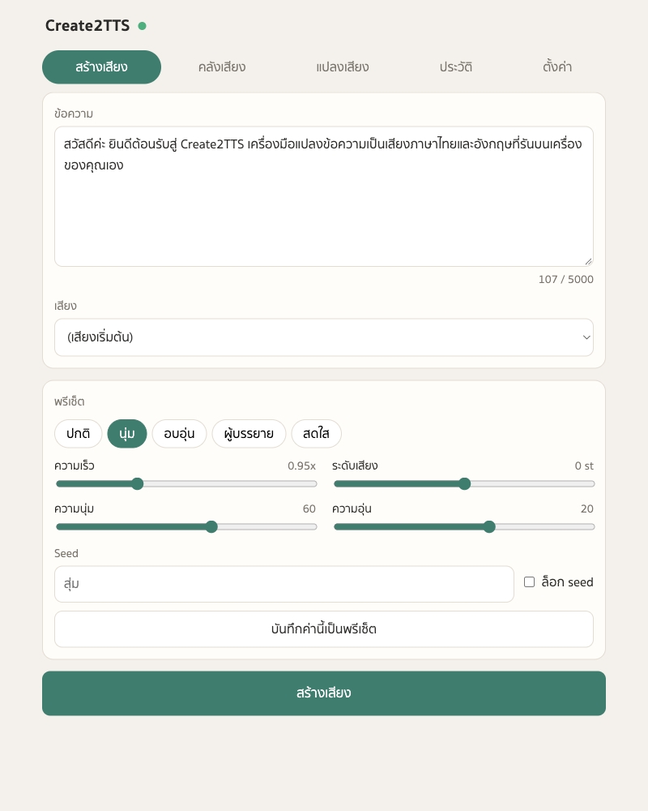
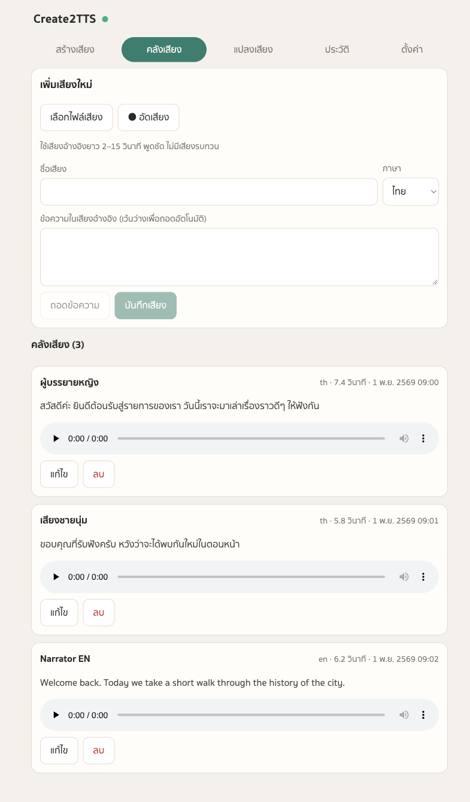
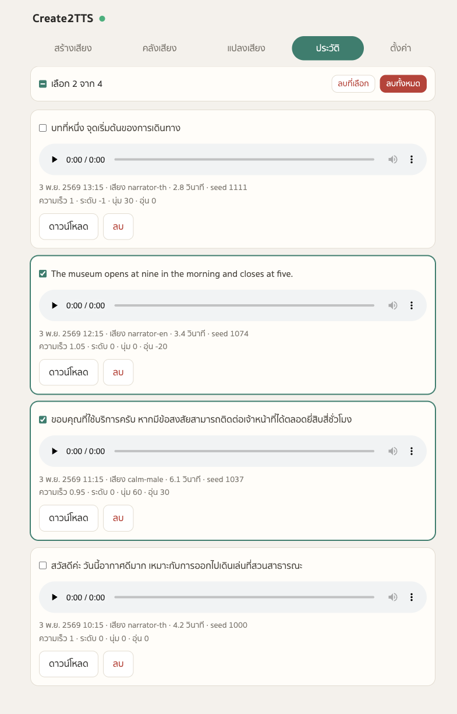
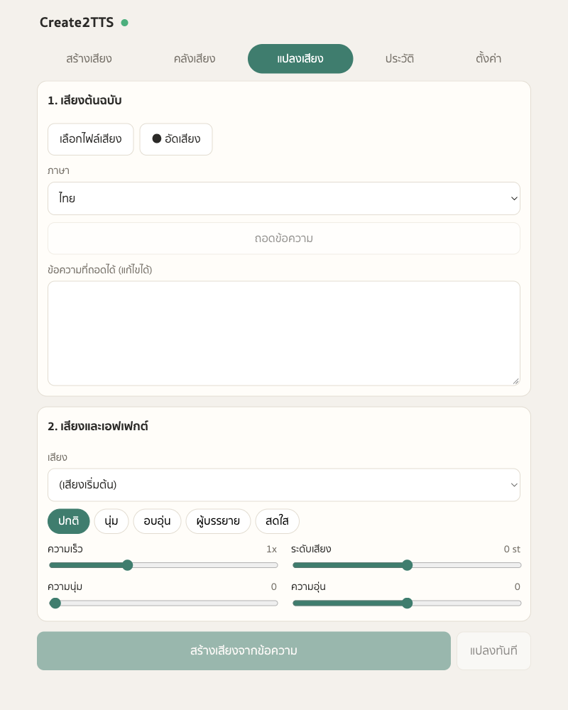
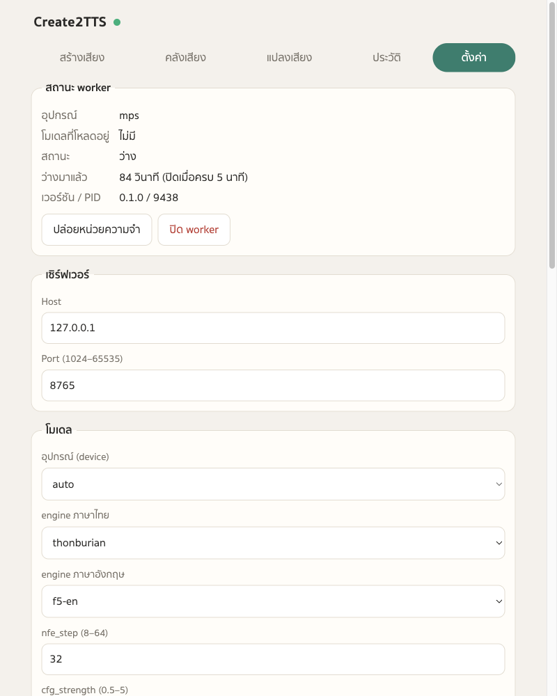

# Create2TTS

Local, free Thai + English text-to-speech with voice cloning, tone/softness controls, a web GUI and an MCP server. Runs on Apple Silicon (MPS) or CPU. No auth — the worker binds to `127.0.0.1` only.

## Web GUI

`uv run tts web` opens five tabs: generate, voice library (upload or record a reference clip), convert a recording into another voice, history (play, download, delete one, selected or all) and settings.

| Generate | Voice library | History |
|---|---|---|
|  |  |  |

| Convert | Settings |
|---|---|
|  |  |

## Setup

```bash
./scripts/setup.sh        # uv sync + build the web GUI
```

Models download on first use into the Hugging Face cache (Thai TTS ~1.3 GB, Thai Whisper ~1.5 GB).

## Use

| What | Command |
|---|---|
| Open the GUI | `uv run tts web` |
| Clone a voice | `uv run tts clone "ชื่อเสียง" clip.wav --text "ข้อความในคลิป" --lang th` |
| Speak | `uv run tts say "สวัสดีครับ" --preset soft --softness 60` |
| Status / stop | `uv run tts status`, `uv run tts stop` |
| Keep the worker up | `uv run tts serve` |

A reference clip should be 5–15 s of clean speech by one speaker, recorded at 24 kHz or higher. Leave `--text` out to transcribe it automatically. Clips under ~4 s or at 16 kHz tend to repeat words or leak the reference text into the output.

## MCP

```bash
claude mcp add -s user tts -- uv run --directory /path/to/Create2TTS tts-mcp
```

Tools: `list_voices`, `list_presets`, `synthesize`, `clone_voice`, `convert_voice`, `delete_voice`, `open_gui`, `tts_status`, `free_memory`. `synthesize` returns the absolute `path` of the audio file.

## Resource use

The MCP server and CLI are light (no torch). The first call starts a worker that loads the model (~2 GB RAM, ~10 s). The worker exits after `idle_timeout_min` (default 5) with no jobs and no open GUI tab; set it to 0 in Settings to exit right after each job.

## Controls

- **speed** 0.5–2.0 — model speaking rate.
- **pitch** −6…+6 semitones.
- **softness** 0–100 — softer highs, gentler dynamics.
- **warmth** −100…100 — negative is brighter, positive is warmer.
- **presets** — ปกติ, นุ่ม, อบอุ่น, ผู้บรรยาย, สดใส; add your own in Settings.

## Data

Everything lives in `data/` (override with `CREATE2TTS_DATA`): `settings.json`, `voices/`, `outputs/`, `worker.log`.

## Licences

ThonburianTTS weights are CC-BY-NC-SA and F5-TTS base weights are CC-BY-NC: personal and internal use only.
